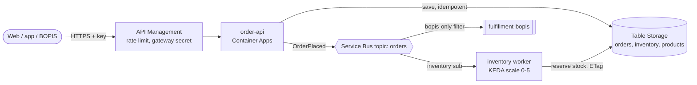

# RetailFlow on Azure

An omnichannel retail order platform on Azure, built to show solution-architecture skills across
stores, merchandising, supply chain and digital channels. Orders from web, app and BOPIS channels
come in through one API gateway, are saved once, and fan out as events to reserve stock and
route pick-up orders, with no service calling another directly.

## Architecture



All apps run in a VNet-integrated Container Apps environment. Key Vault and Table Storage are
reached through private endpoints. Every service has its own managed identity; no keys or
connection strings exist in app config.

## What is built and verified

| Capability | How | Evidence |
|---|---|---|
| Landing zone in Terraform | VNet, subnets, private DNS, managed identities, Key Vault (RBAC, purge protection), ACR (admin off), Log Analytics, App Insights | `infra/` |
| Governance guardrails | Azure Policy: allowed locations (deny), Key Vault deletion protection (audit); CA$75 budget alerts | `infra/governance.tf` |
| API-led integration | API Management: subscription keys per channel, rate limit, gateway secret, correlation ID | Direct call to the app returns 401 |
| Event-driven integration | Service Bus topic with two subscriptions, SQL-filter routing for BOPIS, dead-letter after 5 tries | 3 BOPIS orders, 3 routed messages |
| Idempotency | Idempotency-Key is the order key; retries return the original order | Second identical call returns 200 and the same order |
| Concurrency-safe stock | Optimistic concurrency with ETags (412 then re-read and retry) | Stock 25 to 19 after three 2-unit orders |
| Elastic scale | KEDA scales the worker 0 to 5 on queue depth | Worker idles at 0 replicas |
| Least privilege | One identity per service; roles scoped to one topic, subscription or table account | `infra/*.tf` role assignments |

## Try it

```bash
cd infra && terraform init && terraform apply
GW=$(terraform output -raw gateway_url); KEY=$(terraform output -raw web_key)
curl -X POST "$GW/retail/orders" -H "Ocp-Apim-Subscription-Key: $KEY" \
  -H "Idempotency-Key: $(uuidgen)" -H "Content-Type: application/json" \
  -d '{"storeId":"store-101","channel":"bopis","lines":[{"sku":"SKU-1001","qty":2}]}'
```

## Architecture decisions

| ADR | Decision | Production change |
|---|---|---|
| 0001 | Container Apps over AKS | AKS only for custom operators or GPU pools |
| 0002 | Service Bus Standard with Entra-only auth, no private endpoint | Premium with private endpoint |
| 0004 | Shared gateway secret between APIM Consumption and the apps | APIM Standard v2, internal ingress, JWT validation |
| 0005 | Save then publish (outbox deferred) | Transactional outbox and a saga for multi-line orders |
| 0009 | Table Storage as the dev store after Cosmos DB capacity refusals in three regions | Cosmos DB with reserved capacity in Canada Central + Canada East |

## Roadmap (in progress)

- Store edge: offline-first POS agent with a local outbox syncing to Event Hubs
- Lakehouse: Event Hubs Capture to ADLS bronze/silver/gold
- ML: demand forecast with a baseline quality gate and canary releases; GenAI assistant with guardrails
- Observability: KQL workbook, dead-letter and failure alerts, resiliency test results against NFRs
- CI/CD: GitHub Actions with OIDC, plan-on-PR, Checkov and Trivy scans
